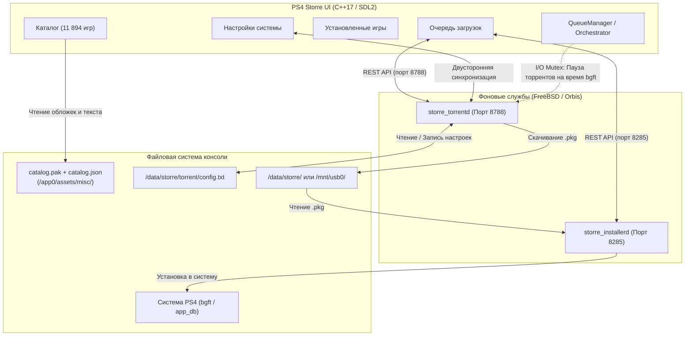
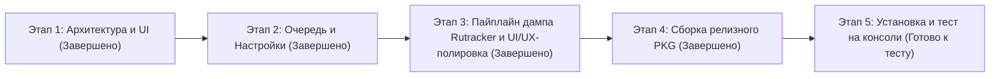

# Документация проекта: PS4 Storre

> [!IMPORTANT]
> Данный документ является единым источником правды (Single Source of Truth) по проекту **PS4 Storre**. Здесь зафиксированы техническое задание, спецификация архитектуры, текущий статус готовности компонентов и план дальнейшей разработки.

---

## 1. Назначение и концепция проекта

**PS4 Storre** — автономный комплексный AIO-комбайн (All-in-One Homebrew Application) для консолей PlayStation 4 (прошивки 5.05 – 14.02+ с GoldHEN).

Приложение объединяет в едином интерфейсе для телевизора (1080p, управление геймпадом):
1. **Офлайн-каталог игр:** **3 699** реально доступных к скачиванию игр с Rutracker (автофильтрация из общей базы на 11 894 записей по наличию торрент-хеша `th`) с обложками, описаниями, размером и поиском.
2. **Фоновый BitTorrent-клиент (`storre_torrentd`):** Автономная фоновая служба скачивания торрентов с собственным веб-интерфейсом для управления с ПК/смартфона.
3. **Фоновый установщик (`storre_installerd`):** Фоновая служба прямой установки пакетов `.pkg` в системную оболочку PS4 через системный сервис `bgft` без зависаний основного интерфейса.
4. **Защита накопителя (HDD I/O Mutex):** Интеллектуальный арбитраж дисковых операций (приостановка раздач и торрент-закачек на время распаковки и установки `.pkg`), предотвращающий зависание механического жесткого диска консоли.

---

## 2. Архитектура системы и потоки данных

### 2.1. Схема взаимодействия компонентов



### 2.2. Сетевые порты и изоляция служб

Для исключения конфликтов с оригинальными приложениями `ps4torrent` (порт 8080) и `ps4installer` (порт 8000), службы PS4 Storre переведены на автономные выделенные порты:
- **`storre_torrentd`:** Порт **`8788`** (REST API + встроенный Web UI).
  - Конфигурация: `/data/storre/torrent/config.txt`.
  - Загрузки по умолчанию: `/data/storre/`.
- **`storre_installerd`:** Порт **`8285`** (REST API фоновой установки).
  - Каталог службы: `/data/storre/installer/`.

---

## 3. Техническое задание (Спецификация требований)

### 3.1. Функциональные требования

#### А. Вкладка «Каталог»
- **TF-01:** Загрузка метаданных 11 894 игр из `catalog.json` за время < 1.0 с.
- **TF-02:** Быстрое O(1) переключение между алфавитными корзинами `[BCE]`, `[#]`, `[A]` – `[Z]` бамперами L2 / R2.
- **TF-03:** Мгновенный поиск по названию игры и Title ID (`CUSAxxxxx`).
- **TF-04:** Карточка игры (Details Modal): отображение обложки, названия, Title ID, Content ID, бейджей статуса/локализации/FW и полного описания игры (без лишних кнопок; запуск и возврат — через цветную панель подсказок геймпада внизу).
- **TF-05:** Динамический LRU-кэш обложек (до 48 текстур в памяти), удержание расхода RAM приложением в пределах 70 МБ.

#### Б. Вкладка «Загрузки»
- **TF-06:** Отображение текущих задач с миниатюрой обложки, Title ID, бейджем статуса, широкой полосой прогресса (на всю ширину карточки) и реальной скоростью загрузки.
- **TF-07:** Управление выбранной задачей с геймпада по контекстным цветным иконкам PS4 в нижней панели:
  - `[Cross]` `Пауза` / `Возобновить`;
  - `[Square]` `Удалить` / `Очистить` (с удалением файлов с накопителя).
- **TF-08:** Информационный баннер в шапке с адресом веб-интерфейса `http://<LAN_IP>:8788/` для управления закачками с ПК или смартфона.

#### В. Вкладка «Установленные»
- **TF-09:** Список установленных на консоли игр с аккуратным статусным бейджем (`Готово к запуску` / `Раздаётся (P2P)`).
- **TF-10:** Запуск выбранной игры `[Cross]` (`Запустить`) и удаление с консоли `[Square]` (`Удалить`) через нижнюю панель геймпада без загромождения карточек кнопками.

#### Г. Вкладка «Настройки»
- **TF-12:** Полное дублирование настроек веб-клиента торрента на экране ТВ:
  1. *Параллельные загрузки:* `1` (по умолчанию для защиты HDD), `2`, `3`, `4`.
  2. *Ограничение отдачи (Seeding):* `32 КБ/с` (по умолчанию), `128 КБ/с`, `256 КБ/с`, `1024 КБ/с`, `Без ограничений`.
  3. *Каталог сохранения:* `Внутренний HDD (/data/storre)`, `Внешний USB 0`, `Внешний USB 1`.
  4. *Автозапуск добавленных задач:* `ВКЛ` / `ВЫКЛ`.
  5. *Возобновление после перезапуска:* `ВКЛ` / `ВЫКЛ`.
  6. *Входящий порт BitTorrent:* `Отключен (0)`, `6881`, `6882`, `6889`.
  7. *Автоудаление .pkg после установки:* `ВКЛ` / `ВЫКЛ`.
  8. *Синхронизация времени системы (NTP):* `pool.ntp.org`.
  9. *Веб-интерфейс торрента:* Отображение адреса `http://<LAN_IP>:8788/`.
- **TF-13:** Окно прокрутки списка настроек (7 видимых строк) с вертикальным скроллбаром и строкой-подсказкой управления.
- **TF-14:** Двусторонняя синхронизация: изменения в Web UI на ПК/телефоне автоматически отображаются в ТВ-интерфейсе через опрос `/api/config`, а изменения с геймпада немедленно сохраняются в демон через `/api/set`.

#### Д. Офлайн-конвейер обновления базы игр (Master -> Release)
- **TF-15:** Разбор официального ежемесячного XML-дампа Rutracker (`rutracker-*.xml.xz`) без распаковки на диск через `lzma` и слияние с полной мастер-базой (`tools/master_catalog/`).
- **TF-16:** Автоматическая упаковка облегчённого релизного каталога ([pack_release_catalog.py](file:///d:/Projects/PS4/ps4_storre/tools/pack_release_catalog.py)) в `assets/misc/`: отбираются только релизы с торрентами (`th`), удаляются неиспользуемые и битые/HTML обложки, после чего пересобирается `.pkg`.

### 3.2. Нефункциональные требования
- **NF-01 (Платформы):** PlayStation 4 (FW 5.05, 6.72, 9.00, 11.00, 14.02+) с GoldHEN payload.
- **NF-02 (Сборка под Windows):** Возможность сборки хост-версии для отладки UI без консоли (`ps4_storre.exe`).
- **NF-03 (Безопасность HDD):** Значение `max_parallel = 1` по умолчанию и автоматическая приостановка активных раздач при записи установочных пакетов на диск.

---

## 4. Матрица реализации компонентов

| Компонент / Фича | Статус | Реализация / Файлы |
| :--- | :---: | :--- |
| **Автономный демон `storre_torrentd`** | ✅ Выполнено | Порт 8788, `max_parallel=1`, [ps4torrent/main.cpp](file:///d:/Projects/PS4/ps4_storre/daemons/ps4torrent/main.cpp) |
| **Автономный демон `storre_installerd`**| ✅ Выполнено | Порт 8285, AOB-скан 14.02+, [ps4installer/src/main.cpp](file:///d:/Projects/PS4/ps4_storre/daemons/ps4installer/src/main.cpp) |
| **Компиляция ELF под PS4** | ✅ Выполнено | [daemons/build_daemons.ps1](file:///d:/Projects/PS4/ps4_storre/daemons/build_daemons.ps1) |
| **AIO ТВ-интерфейс (SDL2)** | ✅ Выполнено | 1080p, 4 вкладки, единая типографика `Noto Sans` (`Regular`/`SemiBold`) по всему UI, квадратные 1:1 обложки (под обложкой `Размер • Год`), L1/R1 и L2/R2 иконки, скроллбары сетки/списков, [src/main.cpp](file:///d:/Projects/PS4/ps4_storre/src/main.cpp) |
| **Встроенная DualShock OSK и защита действий** | ✅ Выполнено | Экранная клавиатура EN/RU (без перекрытия верхнего ряда каталога) по `△` / `F3` и модальные подтверждения (`Exit` / `Delete Torrent` / `Uninstall`) в [src/main.cpp](file:///d:/Projects/PS4/ps4_storre/src/main.cpp) |
| **Автопоиск шрифтов / ассетов** | ✅ Выполнено | Функция `resolve_asset_path()`, `SDL_GetBasePath()`, шрифты [NotoSans-Regular.ttf](file:///d:/Projects/PS4/ps4_storre/assets/fonts/NotoSans-Regular.ttf) и [NotoSans-SemiBold.ttf](file:///d:/Projects/PS4/ps4_storre/assets/fonts/NotoSans-SemiBold.ttf) |
| **Отображение описания в карточке** | ✅ Выполнено | Левая колонка: квадратная обложка 340×340 + статус + облачная сетка бейджей (`ID`, `Год`, `Размер`, `Язык`, `FW`, `DLC`) + перенесённый `Content ID`; правая колонка: только заголовок и увеличенная область скроллируемого описания (`Noto Sans 20px`) |
| **Консольный UI без лишних кнопок** | ✅ Выполнено | Удалены экранные кнопки со всех вкладок; добавлена нижняя панель с цветными PNG-иконками кнопок PS4 (`btn_cross`, `btn_circle`, `btn_square`, `btn_triangle`, `btn_l1`/`r1`, `btn_l2`/`r2`), [src/main.cpp](file:///d:/Projects/PS4/ps4_storre/src/main.cpp) |
| **Очередь скачивания (Пауза/Удаление)**| ✅ Выполнено | Оконная прокрутка (5 строк) + скроллбар, раздельные подписи `ПК-ПРЕВЬЮ` / `ONLINE` в [src/main.cpp](file:///d:/Projects/PS4/ps4_storre/src/main.cpp) и [src/network/orchestrator.cpp](file:///d:/Projects/PS4/ps4_storre/src/network/orchestrator.cpp) |
| **Синхронизация настроек (ТВ ↔ Web)** | ✅ Выполнено | `/api/config` + `/api/set`, единый `/data/storre/torrent/config.txt` |
| **Скроллируемый список настроек (8 строк)**| ✅ Выполнено | Окно 7 строк, трек и скроллбар, зашитый безопасный режим портов (0 = только outbound), политика раздачи Smart Seed (2.0x / 7 дней) в [src/main.cpp](file:///d:/Projects/PS4/ps4_storre/src/main.cpp) |
| **Умная очередь и бэкпорты (FW Filter)**| ✅ Выполнено | Base (0) -> Updates (1) -> DLC (2) -> RUS (3) -> Backport (4), пропуск чужих FW в [pkg.cpp](file:///d:/Projects/PS4/ps4_storre/daemons/ps4installer/src/pkg.cpp) |
| **Жизненный цикл P2P (Seed & Clean)**   | ✅ Выполнено | Сидирование до Ratio 2.0x или 7 дней, автоочистка PKG в [orchestrator.cpp](file:///d:/Projects/PS4/ps4_storre/src/network/orchestrator.cpp) |
| **Гибридный поиск и HDD-индикатор**     | ✅ Выполнено | Алфавит L2/R2, DualShock OSK + поиск по △, бейджи `[RUS]`, `[FW]`, размер на карточке, индикатор свободного места HDD в [src/main.cpp](file:///d:/Projects/PS4/ps4_storre/src/main.cpp) |
| **Сборка Windows хоста (`ps4_storre.exe`)** | ✅ Выполнено | MinGW w64devkit + CMake в [build_win/](file:///d:/Projects/PS4/ps4_storre/build_win/) |
| **Пайплайн сборки базы из XML Rutracker** | ✅ Выполнено | Схема Master (`tools/master_catalog`) -> Release ([pack_release_catalog.py](file:///d:/Projects/PS4/ps4_storre/tools/pack_release_catalog.py) + [update_catalog.ps1](file:///d:/Projects/PS4/ps4_storre/tools/update_catalog.ps1)) |
| **Иконка приложения (`icon0.png`)**        | ✅ Выполнено | 512×512 RGBA, аутентичный 3D-стиль, красный акцент `PS4` (`#FF4B4B`), надпись `STORRE`, [sce_sys/icon0.png](file:///d:/Projects/PS4/ps4_storre/sce_sys/icon0.png) |
| **Сборка релизного PKG (`ps4_storre.pkg`)** | ✅ Выполнено | `IV0000-STOR00001_00-PS4STORRE0000000.pkg` (**131.31 МБ**, облегчённый релиз с Rutracker: 3 699 игр, `NotoSans` шрифты в комплекте), валидация всех 25 контрольных хешей и подписей `[OK]`, [build_pkg.ps1](file:///d:/Projects/PS4/ps4_storre/build_pkg.ps1) |

---

## 5. Дорожная карта (Roadmap)



### Текущий статус:
1. **Релизный Fake PKG собран и верифицирован:**
   - **Файл:** `ps4_storre/release/IV0000-STOR00001_00-PS4STORRE0000000.pkg` (**131.31 МБ**, 137 691 136 байт);
   - **Title ID:** `STOR00001`, **Content ID:** `IV0000-STOR00001_00-PS4STORRE0000000`, **Version:** `01.00`;
   - **UI/UX-обновление 10-foot TV / DualShock:**
     - Шрифты переведены на пропорциональный `Noto Sans` (`Regular`/`SemiBold`), коды/метрики на `DejaVuSansMono`;
     - Встроенная экранная клавиатура EN/RU (без перекрытия верхнего ряда каталога) и защитные модальные подтверждения (`Exit`, `Delete Torrent`, `Uninstall`);
     - Квадратные обложки `1:1`, двухстрочные названия, скроллинг всех списков (`Загрузки`, `Установленные`, `Настройки`) и сетки;
   - **Оптимизация и актуализация базы:** 
     - Полная мастер-база (`11 894` игр, `428.8 МБ`) вынесена в `tools/master_catalog/` для будущих обновлений из дампов Rutracker;
     - В релизный пакет упакованы **только 3 699 игр** с реальными раздачами (`catalog.pak` ужался с **428.8 МБ** до **117.54 МБ**, `catalog.json` — до **856.2 КБ**; отброшены 18 битых/HTML обложек);
   - **Автозапуск демонов:** Интегрирован стриминг ELF в GoldHEN BinLoader (`127.0.0.1:9090`) при старте;
   - **Состав PKG:** `eboot.bin` (FSELF x86_64, 3 576 752 байт), `storre_torrentd.elf`, `storre_installerd.elf`, `catalog.pak` (3 699 игр, обложки, описания), `catalog.json`, шрифты `NotoSans-*` + `DejaVuSansMono`, аутентичные `icon0.png`, `pic1.png`, `param.sfo`, PRX-модули `libc.prx` и `libSceFios2.prx`.
2. **Готовность к установке:** Пакет готов к передаче на PS4 через USB-накопитель (exFAT/FAT32) или удалённый установщик GoldHEN / Remote Package Installer.

---

## 6. Инструкция по сборке и запуску

### Сборка автономных демонов Orbis ELF:
```powershell
powershell -ExecutionPolicy Bypass -File d:\Projects\PS4\ps4_storre\daemons\build_daemons.ps1
```

### Обновление базы игр из Rutracker:
- **Запуск через Проводник:** правый клик по `tools/update_catalog.ps1` -> *«Выполнить с помощью PowerShell»* (или двойной клик по `tools/update_catalog.cmd`). Откроется стандартное окно Windows для выбора файла `.xml.xz` / `.csv`.
- **Запуск из консоли:**
```powershell
powershell -ExecutionPolicy Bypass -File d:\Projects\PS4\ps4_storre\tools\update_catalog.ps1 -DumpPath "D:\Downloads\rutracker-20261101.xml.xz"
```
```powershell
powershell -Command "[System.Environment]::SetEnvironmentVariable('PATH', 'D:\Projects\Tools\w64devkit\bin;D:\Projects\Tools\CMake\bin;' + [System.Environment]::GetEnvironmentVariable('PATH', 'Process'), 'Process'); cmake.exe --build d:\Projects\PS4\ps4_storre\build_win"
```

### Запуск хост-приложения для проверки UI:
```powershell
& 'd:\Projects\PS4\ps4_storre\build_win\ps4_storre.exe'
```
